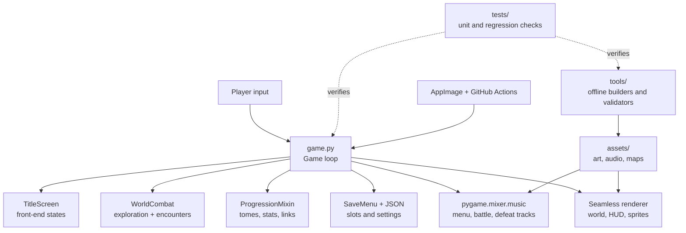
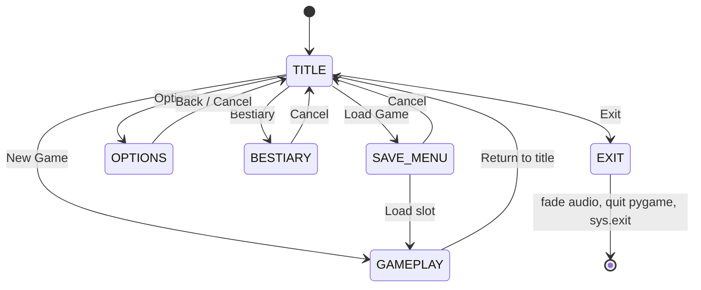
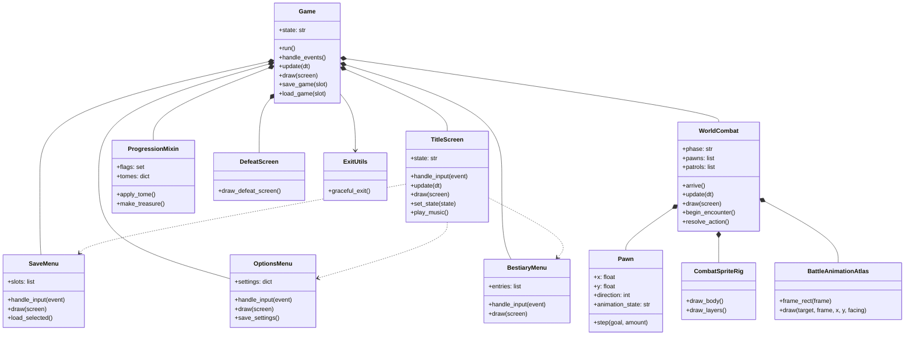
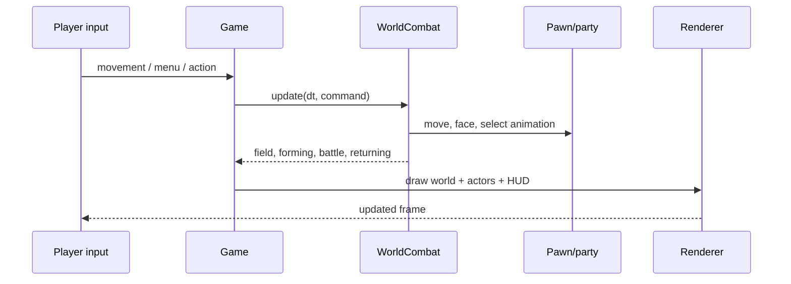
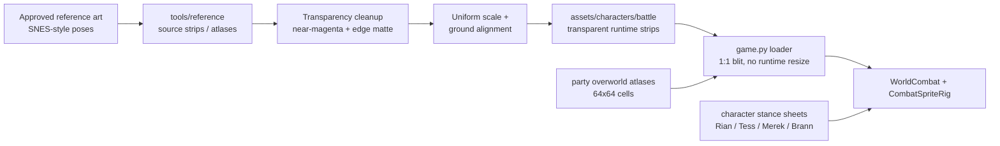

# The Ashen Circuit — Current Architecture UML

This document describes the current GitHub project architecture at the application,
gameplay, asset, and verification levels. It reflects the checked-in Python/Pygame
modules and the current character-animation pipeline.

## System context



## Top-level application state machine



## Runtime module UML



## Gameplay and encounter flow



World encounters preserve room coordinates: exploration transitions into combat
without a separate battle arena or a sprite-size change. Combat actions select
data-driven clips (`battle_idle`, `battle_dash`, `sword_basic`, `sword_skill`,
`hurt`, and `defeated`) and return to the shared field renderer.

## Character asset pipeline



The current convention is 64×64 authored cells and 96×96 runtime battle cells
for the expanded action strips. Frames retain transparency, independent motion,
consistent ground anchoring, and uniform X/Y scaling. Rian's back/up guard strip
is sourced from the approved four-frame replacement and is excluded from any
older top-row sheet import.

## Offline tooling and verification

```mermaid
classDiagram
    class BuildTools {
        build_character_sheets_v2.py
        build_motion_sheet.py
        build_combat_layers.py
        build_battle_animation_atlas.py
        build_authored_stance_atlases.py
    }
    class RianTools {
        fix_rian_battle_transparency.py
        normalize_rian_battle_proportions.py
        replace_rian_back_guard.py
        audit_rian_battle_proportions.py
    }
    class Tests {
        test_title_screen.py
        test_save_menu.py
        test_options_menu.py
        test_bestiary_menu.py
        test_battle_animations.py
        test_rian_transparency.py
        test_seamless.py
        test_progression.py
        test_defeat_screen.py
        test_exit_utils.py
    }
    class Packaging {
        AppImageBuilder.yml
        AppRun
        ashen-circuit.spec
        .github/workflows/publish-release.yml
    }
    BuildTools --> Assets
    RianTools --> Assets
    Tests -. regression coverage .-> Assets
    Tests -. runtime coverage .-> Modules
    Packaging --> Modules
    class Assets
    class Modules
```

## Repository responsibilities

| Area | Main files/directories | Responsibility |
|---|---|---|
| Application | `game.py`, `title_screen.py` | Main loop, top-level states, resource loading |
| Exploration/combat | `seamless.py`, `battle_animations.py`, `combat_poses.py` | Shared field, encounters, actions, actor rendering |
| Menus | `save_menu.py`, `options_menu.py`, `bestiary_menu.py`, `pixel_ui.py` | Front-end UI and persistence-facing controls |
| Progression | `progression.py` | Tomes, stat changes, links, treasure and objective logic |
| Presentation | `render_config.py`, `defeat_screen.py`, `exit_utils.py` | Pixel dimensions, defeat overlay, graceful shutdown |
| Character art | `assets/characters/` | Overworld, battle-ready, combat layers, stance sheets |
| Audio | `assets/audio/` | Menu, battle, and game-over music |
| Build/release | `AppRun`, `AppImageBuilder.yml`, `.github/workflows/` | Executable launch and Linux release packaging |
| Verification | `tests/` | Menu, combat, sprite, transparency, progression, and shutdown checks |
